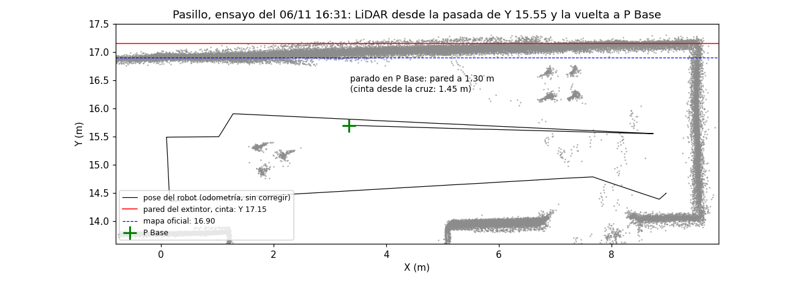

# Localización en el pasillo con sus paredes medidas (análisis offline del 07/11)

Datos: los tres bags del pasillo del 06/11 (datos reales; no es un simulador): ensayo de la fase II desde Q
(`bag_fase1_20261106_163111`), rodeo de R y T (`..._161359`) y aproximación a R con la pose de salida comprobada con la
esquina de Q a ±1 cm (`..._171005`). Script: `autonomous_nav/scripts/evaluar_pasillo.py` (rehace la pose del nodo con
los /odom y /scan grabados, sin y con la corrección, con los parámetros de `config/real.yaml`).

## El problema

En el ensayo de las 16:31 el robot llegó a P Base con 15-20 cm de error (foto). **Parado allí, el LiDAR ve la pared del
extintor a 1.30 m, y la cruz está a 1.45 m de ella (cinta): el error es casi todo en Y, hacia esa pared.** El rumbo no
es el culpable: en P2_e, tras 18 m, la esquina de Q (medida con cinta) da −0.3° de error.

## Qué se ha probado

Teoría: actualización del filtro de Kalman con un mapa conocido (*localization_and_mapping*, diapositivas 9-11): la
predicción de la odometría se combina con lo que mide el LiDAR de paredes de posición conocida.

| Variante | R a la cinta: 16:31 / 16:13 / 17:10 | Error en P Base que detecta (real 15-20 cm) |
|---|---|---|
| Sin corrección (hasta ahora) | 8.7 / 9.4 / 1.2 cm | 2 cm (no lo ve) |
| `ajuste_mapa` con las paredes medidas (extintor, fondo, pared de Q) | 9.9 cm en el 16:31 | 30 cm |
| ídem, solo el extintor (x, y y rumbo) | 5.6 / 12.8 / 6.0 cm | 17 cm |
| **Solo la Y con el extintor, puntos a ≤ 2 m** (`ajuste_paredes`, la elegida) | **7.4 / 9.5 / 1.5 cm** | **16 cm** |
| ídem + fondo (X 9.57) | 4.8 / 4.2 / 12.0 cm | 22 cm |

- Corregir **el rumbo** con la pared del extintor lo mueve 1-2° contra el de la esquina de Q (el del IMU es mejor).
- **El fondo** no es perpendicular (~3° respecto a la pared de Q): el 9.57 de la cinta vale a la altura de Q, a 1.5 m
  de allí ya se aparta ~8 cm (estropea el bag mejor referenciado, el de las 17:10). Visto a 3 m, además, es ruidoso.
- **La pared de Q** y la del extintor discrepan ~8 cm (del orden del error del LDS a 2-3 m: por eso el alcance de 2 m).
- Un rectángulo de pared con su extremo al alcance del LiDAR inventaba una X (los puntos de otra pared junto a la
  esquina): `ajuste_paredes` usa rectas con un tramo, y el tramo solo elige puntos.

**Resultado:** con la elegida, la pose no empeora en ningún bag (±0.3 cm junto a R) y en P Base habría visto y corregido
los ~15 cm. Q, R y P Base se midieron con cinta desde esa misma pared: midiendo la Y respecto a ella, el robot llega a
las cruces aunque la pared no fuera del todo paralela a la sala. La X en el pasillo sigue saliendo de la odometría
(4-9 cm junto a R).

## Pendiente (lunes 09/11)

- Probarla en el robot (activa en `real.yaml`; eventos `CORR_PASILLO` en el Mission Log).
- Medir con cinta, desde la cruz de P Base, la distancia a la pared del tramo ancho (Y ≈ 13.00 en el mapa). **Predicción
  con el LiDAR: ≈ 2.41 m** (desde P Base ve el pasillo de 3.87 m de ancho: 1.30 + 2.56, con el robot 0.15 m más cerca del
  extintor que la cruz). Si sale, esa pared entra en `corridor_wall_*` como Y = 15.70 − medida (≈ 13.29), para X entre
  1.32 y 5.18 (los extremos, a medir).
- Medir el extremo X −0.55 (la distancia de P1_o o de P Base a esa pared): una pared `x` en `corridor_wall_*` corrige la
  X cerca de ese extremo.
