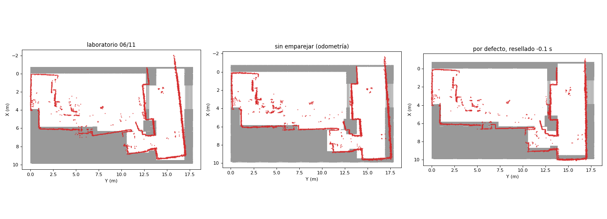
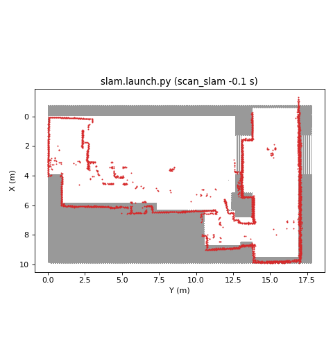
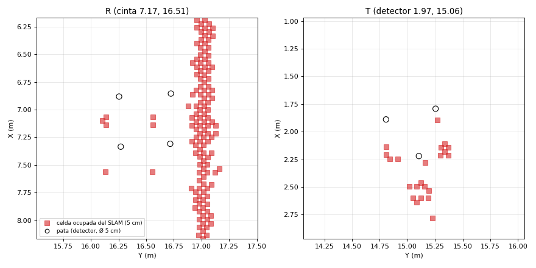

# SLAM en el pasillo: ¿sirve para localizarse? (análisis offline del 06/11)

Datos: el ensayo de las fases I y II con SLAM (bag `bag_fase1_20261106_163111`, logs `mission_log_ensayo_fase{1,2}*`).
slam_toolbox se ha vuelto a pasar por el bag grabado (datos reales, no un simulador) con varias configuraciones
(`docker/slam/slam_bag.sh`, parámetros en `docker/slam/*.yaml`). La pose del SLAM se pasa al mundo con la pose de A al
salir y se compara con referencias medidas (`autonomous_nav/scripts/evaluar_slam.py`).

## Resultados

La medida más fiable es la 4: el centro de la estación R visto por el detector de pilares con esa pose, frente a la
cinta (7.17, 16.51). Las otras: error en la sala hasta la puerta (frente a la pose del nodo, corregida con el mapa) y
en P Base (el robot real quedó a 0.15-0.20 m de la cruz).

| Pose | Sala: media / máx | Rumbo máx en la sala | P Base a la cruz | R a la cinta |
|---|---|---|---|---|
| **Nodo** (odometría + corrección con el mapa + RELOC puerta y Q) | — | — | 0.15-0.20 (real) | **0.08** |
| slam_toolbox sin emparejar scans (= odometría del robot) | 0.18 / 0.58 | 3.0° | 0.15 | 0.29 |
| slam_toolbox por defecto (el del laboratorio, grabado) | 0.29 / 0.71 | 10.4° | 0.64 | 0.68 |
| ídem, vuelto a pasar | 0.32 / 0.78 | 9.4° | 0.58 | 0.59 |
| `odom.yaml` (búsqueda ±5°, penalizaciones fuertes) | 0.30 / 0.73 | 4.0° | 0.80 | 0.83 |
| `rango35.yaml` (alcance 3.5 m, más scans) | 2.06 / 6.44 | 23.5° | 8.20 | 6.75 (cierre de bucle falso) |
| por defecto, **scan resellado −0.1 s** | 0.21 / 0.37 | 3.0° | 0.55 | 0.39 |
| `odom.yaml`, scan resellado −0.1 s | 0.21 / 0.55 | 3.2° | 0.61 | 0.65 |

**Conclusión:** con este LiDAR (LDS, 3.5 m, 5 Hz) y estas salas, emparejar scans empeora la pose en vez de
corregirla. Ninguna configuración se acerca a la pose del nodo, así que **no se ha conectado el SLAM a `pose_mundo()`**.

## El scan llega con ~0.1 s de retraso

`autonomous_nav/scripts/retraso_scan.py`: los scans tomados girando en la sala, proyectados con la pose de
(sello − δ), quedan más pegados a las paredes del mapa con **δ = +0.10 s** (4.30 cm de media, frente a 5.14 cm con
δ = 0); sin girar, la curva es plana (control). Cuadra con el LDS: una vuelta cada 0.2 s, sellada al final. Girando a
0.9 rad/s, el scan queda ~5° girado respecto a la pose. Al nodo no le afecta (la memoria de obstáculos, el detector de
pilares y la corrección con el mapa no usan scans tomados girando deprisa; las relocalizaciones, parado). Al SLAM sí:
resellar baja el error de rumbo de 9.4° a 3.0°.

## Mapas (entregable)

En gris, el mapa oficial; en rojo, las celdas ocupadas del SLAM en el mundo. El del laboratorio tiene el pasillo girado
y el vestíbulo deformado. Sin emparejar scans o con el scan resellado salen mucho mejor (el resellado duplica algunas
paredes del vestíbulo). En los tres, la pared larga del pasillo sale en Y ≈ 17.1, como la cinta (17.15) y no como el
mapa oficial (16.90).

## Opciones (a decidir)

1. **Localización en el pasillo:** en vez del SLAM, corregir la pose con las paredes del pasillo, como ya hace
   `ajuste_mapa` en la sala. Hoy está apagado a partir de Y 10.2 porque el mapa está mal en el pasillo; haría falta
   corregir el mapa con las paredes medidas con cinta (pared del extintor Y 17.15, pared de Q 13.997, fondo X 9.57).
2. **Mapa entregable:** slam_toolbox con el scan resellado −0.1 s (un nodo pequeño que reenvía /scan con el sello
   corregido) o sin emparejar scans. Hay que grabarlo de nuevo en el laboratorio, con el mismo bag como respaldo.

## 07/11: mapa entregable con el scan resellado (`launch/slam.launch.py`)

Decidido: el nodo `scan_slam` reenvía `/scan` a `/scan_slam` con el sello −0.1 s, y slam_toolbox (parámetros por defecto,
`config/slam.yaml`, solo cambia `scan_topic`) lee ese. Comprobado pasando el bag del ensayo (16:31) por el launch tal cual
(`docker/slam/mapa_bag.sh fase1_20261106_163111 entregable`): el mapa sale recto (el del laboratorio tenía el pasillo
girado).

**Las patas de las estaciones salen en el mapa** (el enunciado pide "charging station pillars"): entre las celdas
ocupadas sueltas del pasillo, el detector de pilares encuentra R como cuadrada (4 celdas, 44 cm, −0.6°) y T como
triangular. En el marco del mapa, R queda a ~0.23 m de la cinta: el SLAM se localiza peor que el nodo en el pasillo (por
eso no se usa para navegar), pero el mapa es coherente.

