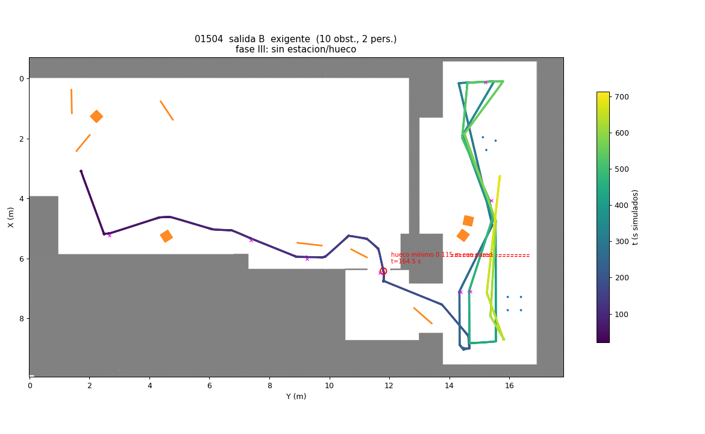

# Fallo intermitente: fase II sin confirmar la estación cuadrada

**Estado:** sin corrección. Es intermitente y la segunda cobertura ya lo mitiga. El robot se comporta de forma segura:
vuelve a P Base, escribe `ESTACION_NO_ENCONTRADA` y no hace la fase III (`FASE_III_SIN_ESTACION`).

## Qué pasa

Batería del 07/11: 2 de 300 misiones, las dos de dificultad exigente.
- **01086:** las pasadas de la cobertura se deformaron al replanificar alrededor de los obstáculos, y el robot nunca pasó
  a menos de 1.28 m del centro de R (la pasada normal pasa a 0.62 m). A esa distancia una pata da 0-1 puntos del LiDAR.
- **01504:** sí pasó a 0.62 m de R, recto y casi sin girar, y no la confirmó. Sin el `/scan` grabado no se puede saber
  por qué.

Repitiendo los dos escenarios, **los dos funcionan**: 01504 encuentra R en la primera pasada y 01086 en la segunda
cobertura. Depende de cómo se cruce la persona simulada y de por dónde lleven los replanes.

## Posibles mejoras (sin hacer)

1. Al replanificar durante la cobertura, el camino entre dos puntos de la pasada busca holgura y se separa de la línea
   de la pasada. Se podría replanificar solo hasta el siguiente punto de la pasada y no hasta P Base.
2. Si la cobertura acaba sin la cuadrada pero con pilares sueltos vistos (grupos con pocas detecciones), ir a mirarlos
   de cerca antes de la segunda cobertura.
3. Grabar `/scan` en la simulación para los casos que fallen, y repasar el detector con esos datos.

## Cómo verlo en el laboratorio

Difícil de reproducir a propósito. Lo más parecido: paneles en el pasillo entre P1 (Y 14.35) y P2 (Y 15.55), cerca de
X 6-8, que obliguen a rodear justo antes de pasar junto a R. Si sale `ESTACION_NO_ENCONTRADA`, guardar el bag (con
`/scan`) para repasar el detector.
