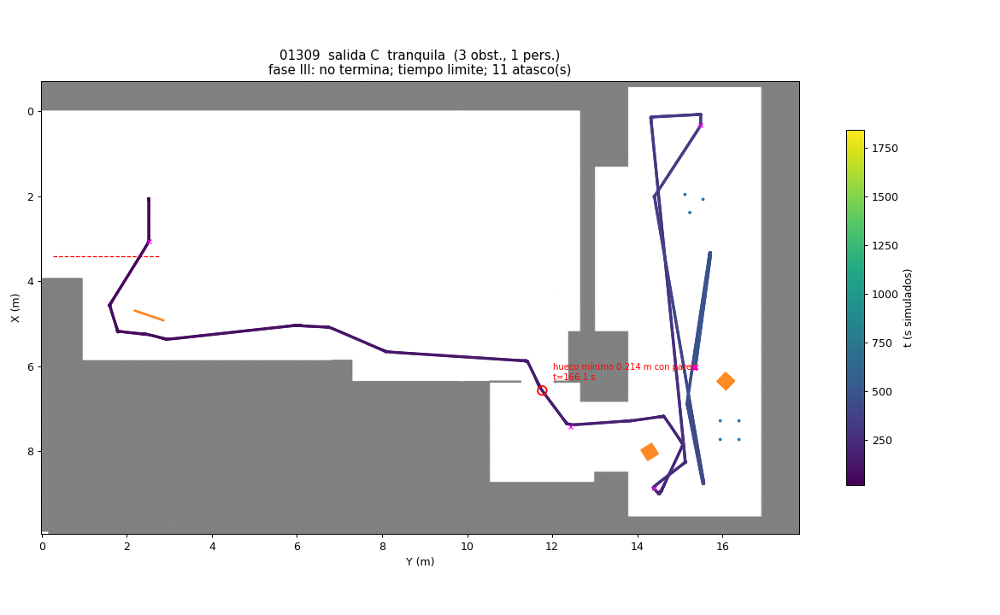

# Fallo: fase III, punto de delante de la estación tapado (SIN_CAMINO para siempre)

**Estado:** corregido en la rama `arreglo-fase3-lado` (sin fusionar). Hay que verificarlo en el robot.

## Qué pasa

Al empezar la fase III, el nodo elige el lado de la estación cuadrada por el que entrar: el más cercano al robot que
tiene sitio en el mapa. Si hay un obstáculo (panel, caja) junto al punto de delante de ese lado (a 0.80 m del centro),
ese punto no tiene camino. El nodo no prueba otro lado: escribe `SIN_CAMINO` cada 5 s hasta que se le para.

Batería del 07/11 (300 misiones en Gazebo): 3 casos, semillas **01017, 01309 y 01400**. En los tres, el obstáculo
estaba en el lado de R que da a P Base (el más cercano viniendo de P Base), a 1.05-1.56 m del centro:

| Semilla | Obstáculo | Posición respecto al centro de R |
|---|---|---|
| 01309 | caja de 0.3 m | 1.15 m hacia P Base (−X), 0.09 m hacia el pasillo |
| 01400 | panel de 1.02 m, girado 118° | 1.05 m hacia P Base, 0.17 m hacia el pasillo |
| 01017 | panel de 0.93 m, girado 163° | 1.56 m hacia P Base, 0.21 m hacia la pared |

## Cómo montarlo en el laboratorio

1. Misión completa, o como mínimo fases II y III (`-p phase2_enabled:=true -p phase3_enabled:=true`).
2. Estación R en su sitio, centro en la cruz (7.17, 16.51).
3. **Un panel de madera de pie, a ~1.1 m del centro de R en dirección a P Base**: centro del panel en (6.07, 16.51),
   girado unos 30° respecto al eje X (para que tape el punto de delante, que está en (6.37, 16.51)). Que deje libre el
   lado del pasillo: el punto (7.17, 15.71) y el camino hasta él.
4. Sin la corrección (rama `fase2-pilares`): tras `FASE III INICIO`, `FINAL_SIN_CAMINO` / `SIN_CAMINO` sin fin.
   Con la corrección: el robot va directo al lado del pasillo, o, si al salir aún no había visto el panel, a los 10 s
   sin camino escribe `FASE3_OTRO_LADO` y cambia de lado. Después `FASE3_CENTRO`, `FASE3_DENTRO` y
   `FASE III COMPLETADA`.

## La corrección

- `ir_delante` elige el lado con la holgura del mapa **más los obstáculos que ha visto el LiDAR** (como el planificador
  al replanificar).
- `cambiar_de_lado`: en ESPERAR, si el punto de delante lleva `phase3_side_wait` s (10) sin camino, se descarta y se va
  al siguiente lado. Si no queda ninguno, `FASE_III_SIN_HUECO` (no entra).
- Para comparar en el laboratorio: `-p phase3_side_wait:=0.0` vuelve al comportamiento de antes (salvo la elección del
  lado con los obstáculos vistos).

Verificado en Gazebo con las tres semillas: completan la misión y aparcan a 0.3-0.5 cm del centro. Tests:
`test_fase3.py` (`test_panel_delante_del_lado_mas_cercano_elige_otro`, `test_sin_camino_un_rato_cambia_de_lado`).
